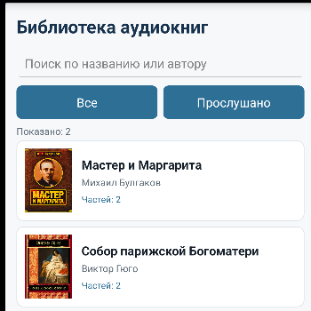
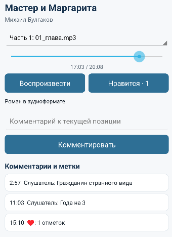
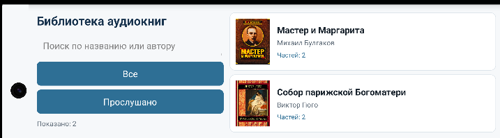

# Руководство пользователя

## Каталог

После запуска клиент загружает список книг. Строка поиска фильтрует уже полученные данные по названию и авторам. Кнопки «Все» и «Прослушано» переключают категории. Нажатие по книге открывает экран воспроизведения.

## Прослушивание

Кнопка «Воспроизвести» запускает текущую часть. Ползунок показывает позицию и позволяет перейти к другому месту. Позиция сохраняется каждые пять секунд и при закрытии экрана. При следующем открытии книга продолжается с сохраненного места.

Книга считается прослушанной, когда достигнуто не менее 95 процентов общей длительности последней части. Статус хранится на мобильном устройстве.

## Комментарии и отметки

Во время воспроизведения введите текст и нажмите «Комментировать». Сервер сохранит комментарий вместе с текущей временной меткой. Нажатие по существующему комментарию переводит проигрыватель к его позиции.

Кнопка «Нравится» добавляет отметку в текущую точку. Один идентификатор устройства может поставить только одну отметку на одной временной метке части.

## Горизонтальная ориентация

При повороте устройства Android использует отдельную компоновку: панель поиска и категорий располагается слева, каталог — справа. Состояние каталога загружается заново, а позиция проигрывателя восстанавливается из локальной базы.

## Возможные затруднения

- Если каталог пуст, проверьте структуру `server/data/audio` и перезапустите контейнер.
- Если клиент не подключается, проверьте базовый URL и доступность порта 8080.
- Если переход по времени не выполняется, убедитесь, что формат файла поддерживает произвольное позиционирование.

